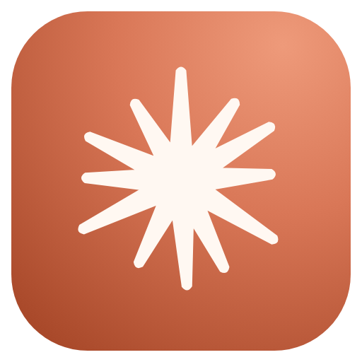

# Claude Code Academy

A desktop study app for **Claude Code** and the **Claude Certified Architect – Foundations** exam, with Python basics on the side. Claude orange throughout, beginner-friendly, and hands-on.



## What's inside

| Tab | What it does |
|---|---|
| **Home** | Ready-meter, XP & levels, study streak, your weakest exam domain, quick links |
| **My Study Plan** | 5-week checklist and exam-date countdown |
| **Simulator** | A **mock desktop** (Terminal, Files, Code editor, **Browser**, Quick Reference, taskbar & start menu) running a scripted Claude Code session. 21 guided missions, from first launch through CLAUDE.md, fixing a bug, plan mode, permissions, commands & skills, subagents, hooks, MCP, context management and headless/CI, plus **Browser clicks with Playwright MCP** (watch Claude click by element ref, then turn it into a test), **Computer use** (an animated cursor moves and clicks from screenshots, with a human-approval step), **Build your own MCP server**, plus three GitHub missions: **GitHub flow with Claude** (branch → PR → review → merge, with a simulated PR page), **@claude on GitHub** (install the GitHub Action, watch @claude answer an issue) and **Fix a failing CI run**, plus **Ship a hosted Managed Agent**, **Self-host an agent with the Agent SDK**, and **Cowork** in a simulated Claude desktop app (connect a folder, approve a plan, allow/deny actions, `/schedule`), and **Context engineering in Claude Code** (slim CLAUDE.md with path rules, subagent notes, compaction). Every highlighted word is explained, a **Coach** panel says what to do and what just happened, and config files open with **line-by-line annotations**. Free-play mode understands ~40 real commands. |
| **Lessons** | 22 lessons from "what is a terminal?" to multi-agent design, each with quick checks and a link to the matching simulator mission |
| **Connect & Automate** | The MCP & API hub: 12 chapters on how Claude's actions reach real tasks. MCP explained (hosts, transports, tools/resources/prompts), every `claude mcp` command, **building your own MCP server in Python** (tested against MCP SDK 2.x), Claude Desktop config, the **Claude API** from zero, tool use and the agent loop, the MCP connector and Agent SDK, **computer use** (all 17 actions + a complete Python loop), **browser automation** five ways (Playwright MCP, Claude in Chrome, the API browser toolset, Playwright scripts, computer use), desktop recipes, and a safety checklist. Includes an **Agent Loop Visualizer** that steps through the exact JSON, and a "which approach should I use?" picker |
| **Context & Memory** | 12 chapters on context engineering: what it is (write/select/compress/isolate), tokens & budgets, context in Claude Code (CLAUDE.md diet, rules, scratchpads, subagents) and in Claude chat/Cowork, **prompt caching** done properly (silent invalidators, economics), long conversations (context editing, compaction, case facts), persistent memory (memory tool, memory stores), **RAG** from first principles incl. contextual retrieval, context-efficient tools, Files API & citations, patterns and pitfalls. Two labs: the **Context Budget Visualizer** and the **Prompt Cache Lab** |
| **Claude Chat & Cowork** | 12 chapters on using Claude itself: plans, prompting in chat, **Projects** (storing context), artifacts & file creation, memory & incognito, web search & Research, connectors/skills/plugins, power tips; **Cowork** explained (it's merging with chat), your first task step by step, permission modes (Manual/Auto/Skip), browser & computer use, scheduled tasks, safety; and a "Which Claude should I use?" picker |
| **Build Agents: hosted vs self-hosted** | 10 chapters: who runs the loop vs the tools, self-hosting with the Messages API, the **Claude Agent SDK** hands-on (checked against `claude-agent-sdk` 0.2.x), deploying it (containers, patterns, security, cost), **Claude Managed Agents** concepts, building one in Python, power features (vaults, memory stores, outcomes, multi-agent, scheduled deployments, budgets), self-hosted sandboxes, a side-by-side comparison and operations; plus a **Hosting decision wizard** |
| **GitHub & Claude** | 15 chapters: git and GitHub from zero (Windows-friendly setup, the everyday workflow, undo, branches, PRs, merge conflicts, rulesets, issues & Projects), Claude Code as your git partner (permission rules for git), the GitHub CLI, the GitHub MCP server, **@claude with the Claude Code GitHub Action** (`/install-github-app`, subscription token, automation mode), Claude Code on the web (`--cloud`, `--teleport`, Auto-fix), Actions CI basics, a Claude-ready repo checklist, GitHub security, releases/Pages/portfolio, and trainings, certifications & must-reads. Includes the **Git Playground**: type real git/gh commands, watch a live commit graph, and complete 7 challenges (incl. a teammate push, a merge conflict and a full PR) |
| **Cheat Sheet** | Commands, keys, Git & GitHub, MCP, browser & computer automation and every config file, click to copy |
| **Glossary** | 80 terms in plain English, tagged with the exam domain they belong to; hover any highlighted term anywhere in the app |
| **Exam Guide** | Format, the 5 domains & weights, task statements, the 6 scenarios, decision principles, exam-day tactics, sources |
| **Practice Tests** | 79 original scenario questions with explanations; quick 10, domain drills, timed mock exam, mistakes review, history. Answer order is shuffled every time |
| **Flashcards** | Spaced repetition over the whole glossary, by domain or category |
| **Ask Claude** | An AI tutor that knows the app's content. Uses Claude through your API key (streaming, with prompt caching, and retrieval: the 3 most relevant in-depth chapters are attached to each question); works **offline** from the built-in knowledge base without a key |
| **Python Basics** | 12 lessons (incl. a runnable mini-RAG) with a **live playground** that runs code on your own Python |
| **Python Certifications** | PCEP → PCAP → PCPP1, CS50P, freeCodeCamp, Google IT Automation, and links |
| **What's Next** | Models, Claude Code features, API platform, learning & certs, your 4-month roadmap |
| **Resources** | ~105 curated links: official docs, Claude apps & agents, GitHub & git, MCP & automation tools, Claude Academy courses, engineering must-reads, exam guides, SDKs |
| **Settings** | API key (encrypted), tutor model & effort, Python path, light/dark theme, export/import/reset progress |

Global search (**Ctrl+K**) finds lessons, terms, questions, commands, missions and links. Press Enter on no match to ask the tutor.

## Run it on Windows

**Option A: from this folder (easiest)**
1. Double-click **`START-ACADEMY.bat`**.
   - If Node.js isn't installed it installs it (via `winget`); then double-click again.
   - The first run downloads the app's parts (1–2 minutes). After that it opens instantly.

**Option B: a normal installer**
- Double-click **`BUILD-INSTALLER.bat`**. It creates `dist\Claude Code Academy Setup 1.0.0.exe` with Desktop and Start-menu shortcuts.
- Or download the installer GitHub builds automatically: **Actions → "Claude Code Academy installer" → latest run → Artifacts**.
- The installer isn't code-signed, so Windows may say "Windows protected your PC": click **More info → Run anyway**.

macOS/Linux: `npm install && npm start` (or `npm run dist:mac` / `npm run dist:linux`).

## The AI tutor (optional API key)

Without a key, **Ask Claude** answers from the app's own glossary, lessons and questions. With a key it can answer anything:

1. Go to https://platform.claude.com → **Billing** (add a little credit) → **API Keys → Create Key**.
2. In the app: **Settings → paste the key → Save**.

The key is encrypted with your operating system's keychain (Electron `safeStorage`) and stored only in the app's data folder; the app's pages never see it. An `ANTHROPIC_API_KEY` environment variable also works. Default model: Claude Opus 5.5 at medium effort (changeable in Settings). Each answer typically costs a cent or two; the long tutor instructions are prompt-cached, so follow-ups are cheaper.

## Python playground

Uses the Python on your computer (`py`, `python` or `python3`). Code runs isolated (`python -I`) with a 10-second limit. If it isn't found, install Python from python.org (tick **Add python.exe to PATH**) or run `winget install Python.Python.3.13`, or set a path in Settings.

## For tinkerers

```
claude-code-academy/
├── main.js              Electron main process: window, API key, tutor streaming, Python runner
├── preload.js           The only bridge between pages and the main process
├── scripts/check-content.js   `npm run check`: validates all content cross-references
└── src/
    ├── index.html, styles.css
    └── js/
        ├── core.js      storage, XP, markdown, highlighting, tooltips, router
        ├── app.js       shell, navigation, search, theme
        ├── data/        ALL content: glossary, lessons, exam, questions, missions, python, resources, kb
        └── views/       one file per tab (simulator.js is the mock desktop)
```

Content lives in plain JavaScript data files, so adding a lesson, term, question or mission is just editing `src/js/data/*.js`. Run `npm run check` afterwards. `npm start -- --dev` opens DevTools.

## Accuracy note

The Connect & Automate code was checked in November 2026 against the real packages: the MCP server example was run with `mcp` 2.3.0 and tested with an MCP client, and the computer-use loop was run with `anthropic` 2.12.0 against a mock API. Note that `pip install "mcp[cli]"` now gives MCP SDK 2.x, where `FastMCP` is renamed `MCPServer`, so older tutorials break.

Exam facts (60 questions, 120 minutes, 720/1000 to pass, domain weights) come from published study guides, not an official Anthropic exam guide. Claude Code and the API change quickly. The app links to the official docs everywhere, and you should confirm exam logistics on Anthropic's certification page before booking. Practice questions are original, written in the style of the exam; they are not real exam items.

*An independent study tool. Not affiliated with or endorsed by Anthropic. The starburst mark is an original drawing in Claude's colors.*
